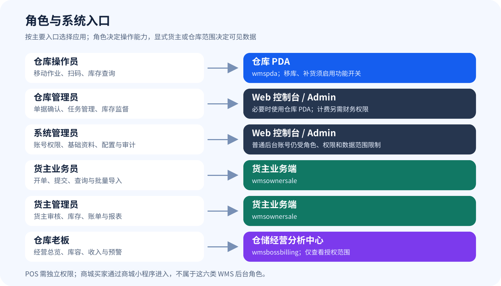

# 金桥融通仓库管理系统（WMS）操作手册

**文档版本：** V2.1

**适用系统版本：** 2026-09-07 当前工作区业务基线

**适用对象：** 仓库操作员、仓库管理员、货主业务员、货主管理员、系统管理员、仓库老板

**文档状态：** 交付版

> 本合订版与六本角色分册由同一组源内容构建。培训和岗位发放优先使用对应角色分册。

## 系统组成与角色入口

- **仓库 PDA（wmspda）**：现场收货、上架、代办出库、拣货、复核、库存和仓库报表。
- **货主业务端（wmsownersale）**：授权仓库选单、货主开单、审核、库存、履约、销售报表和账单。
- **仓储经营分析中心（wmsbossbilling）**：老板只读查看经营、库存库容、收入计费和预警。
- **Web 控制台 / Django Admin**：仓库管理、系统配置、基础资料、权限和审计。

| 角色 | 正式权限组 | 主要入口 | 数据范围 |
|---|---|---|---|
| 仓库操作员 | `WMS::仓库操作员` | 仓库 PDA（wmspda） | 一个明确的仓库范围 |
| 仓库管理员 | `WMS::仓库管理员` | Web 控制台 / Django Admin，必要时使用仓库 PDA | 一个明确的仓库范围 |
| 货主业务员 | `WMS::货主业务员` | 货主业务端（wmsownersale） | 一个明确的货主范围，并从货主已授权仓库中选择履约仓库 |
| 货主管理员 | `WMS::货主管理员` | 货主业务端（wmsownersale） | 一个明确的货主范围 |
| 系统管理员 | `超级管理员或经过审批的后台管理权限组` | Web 控制台 / Django Admin | 超级管理员为全局范围；普通后台账号仍受显式角色范围和权限限制 |
| 仓库老板 | `WMS::仓库老板` | 仓储经营分析中心（wmsbossbilling） | 一个或多个明确授权的仓库范围 |

“仓库主管”只作为企业岗位称谓。需要单据确认和任务管理时使用 `WMS::仓库管理员`；旧组名“仓库主管”会被兼容代码识别为仓库老板。

## 登录、账号与通用安全

### 首次登录

1. 从系统管理员处取得正式入口、用户名和初始密码。
2. 打开本岗位对应的应用或 Web 地址，输入用户名和密码。
3. 登录后核对显示姓名、业务角色以及货主或仓库范围。
4. 首次登录立即进入“我的 → 修改密码”或 Web 右上角密码修改入口。
5. 如果能够登录但没有菜单，不要借用其他账号，记录用户名、入口和页面截图并联系系统管理员。

### 登录失效与切换账号

1. 使用管理员提供的正式入口；客户端的服务地址由部署配置决定，不在登录页自行改接其他服务器。
2. 使用过程中客户端会尝试续期登录。临时断网或服务器繁忙时先检查网络，恢复后重新查询当前单据；不能把网络故障当成业务未提交。
3. 明确提示登录失效并返回登录页时，重新登录本人账号，再核对角色、仓库或货主范围。
4. 看到“登录账号已变化”或“登录状态已变化”时停止当前操作，刷新页面并重新选择业务对象。旧账号的页面结果不能作为新账号继续操作的依据。
5. 连续登录过频时按提示等待，不连续点击；仍不能登录则联系管理员检查账号。

### 账号和数据范围

- 一人一号，不得共用账号或把密码留在 PDA、电脑旁。
- 角色决定能够执行什么操作；显式角色范围决定能够操作哪个货主或仓库的数据。
- 普通 WMS 用户只能启用一种业务角色。除仓库老板可授权多个仓库外，其他角色只能有一个活动范围。
- 超级管理员使用全局权限，不设置业务角色范围；超级管理员账号不得用于日常开单、审批和现场作业。
- 离职、调岗、合作终止或设备丢失后，应立即停用账号并保留审计记录。

### 通用操作原则

1. 操作前核对货主、仓库、客户、商品、批次、库位和单据号。
2. 扫码后必须核对系统命中的商品名称和规格，不能只凭提示音继续。
3. 审核、复核、过账、取消和库存调整会改变业务状态或库存，提交前必须再次确认。
4. 系统提示成功后再离开页面；网络中断时先查询原单状态，确认未成功后才重试。
5. 禁止通过直接修改库存明细来代替正常收货、上架、拣货、复核、盘点或调整流程。
6. 页面入口可见不代表账号一定有执行权限；最终以服务器返回的角色、权限和数据范围校验为准。

### 修改密码与退出

1. 修改密码时输入原密码、新密码和确认密码；新密码必须通过系统安全校验。
2. 修改成功后退出，并用新密码重新登录验证。
3. 当班结束或共用设备交接前必须从“我的”或用户菜单执行退出，不能只关闭屏幕或浏览器。
4. 切换账号前先记录尚未确认的单号、任务号及收付款结果；下一位人员使用自己的账号重新打开业务页面，不接着提交上一账号遗留的内容。

---

## 常见状态与控制点

| 状态 | 含义 | 操作要求 |
|---|---|---|
| 草稿 / DRAFT | 单据尚未正式提交 | 原创建人可在权限允许时修改、提交或删除未生效内容 |
| 待货主审核 / OWNER_PENDING | 业务员已经提交 | 等待货主管理员通过、退回或取消 |
| 货主已通过 / OWNER_APPROVED | 商业条件已确认，库存可能已冻结 | 等待仓库管理员确认并发布任务 |
| 待仓库确认 / WHS_PENDING | 等待仓库接单 | 仓库管理员检查仓库、库存和履约条件 |
| 仓库已确认 / WHS_APPROVED | 已进入仓库履约 | 不得随意修改原订单 |
| 保留 / RESERVED | 任务已因货主审核创建但尚未发布 | 仓库确认前不得现场执行 |
| 待发布 / READY | 任务具备发布条件 | 由仓库管理员发布 |
| 已发布 / RELEASED | 操作员可以领取或执行 | 按任务逐行扫描作业 |
| 执行中 / IN_PROGRESS | 已发生现场作业记录 | 继续完成剩余任务行，不得另建重复任务 |
| 已完成 / COMPLETED | 作业数量已经完成 | 等待复核、审核或过账 |
| 待审核 / PENDING | 需要复核或管理确认 | 核对实物、数量、批次和库位 |
| 已过账 / POSTED | 库存影响已正式生效 | 错误只能通过规范冲销或批准的调整处理 |
| 过账失败 / FAILED | 库存写入没有成功完成 | 保留原任务号和错误信息，交管理员处理 |
| 已驳回 / REJECTED | 审核未通过 | 查看原因并按流程修改、重提或终止 |
| 已取消 / CANCELLED | 单据或任务终止 | 核对冻结库存是否释放、现场实物是否隔离 |
| 异常 / EXCEPTION | 移库任务处于异常执行状态 | 操作员说明现场情况，管理员处理原因后决定恢复或作废 |

关键控制点：

- 货主管理员审核是商业确认，仓库管理员确认是履约确认，两者不能互相替代。
- 标准出库必须先完成货主审核，再由仓库管理员确认发布；系统已停用仓库端代替货主审批的一键流程。
- 拣货完成不等于库存已经扣减；以任务过账状态 `POSTED` 和库存流水为准。
- 取消、撤回或驳回涉及已冻结库存时，必须核对分配量已经释放；任务已开始或已有执行数量时，系统会阻止直接取消。
- 移库和补货需要同时看任务状态、行完成量和过账状态；分次扫描只累计执行数量，库存移动以整任务过账成功为准。
- 移库异常执行状态与过账失败不是同一件事；“恢复”用于异常任务，“重试过账”用于过账失败，均由有权限的仓库管理员处理。
- POS 销售状态和班次状态按《POS 使用手册》核对；现场还款或打印完成情况不能由普通仓库任务状态推断。

---

## 仓库操作员操作指南

### 角色职责与权限

仓库操作员负责授权仓库内的现场收货、上架、拣货、复核及查询；移库和补货启用后，也按授权参与申请与执行。规范角色组为 `WMS::仓库操作员`，必须配置一个活动的仓库角色范围。

默认能力包括：仓库现场作业、无订单收货、查看仓库运营报表、查看和领取任务，以及在满足货主授权时执行代货主出库。

以下能力不是默认权限：

- 商品 Excel 导入需要额外的商品导入权限，首页以服务端 `can_import_products` 能力为准。
- POS 收银、销售报表、对账、退款等需要独立 POS 权限，操作方法见专项 POS 手册。
- 仓库操作员不能确认货主订单、执行仓库管理员审核、调整角色权限或直接修改库存。

规范角色包含移库和要货申请权限，但申请、现场执行以及整容器移库分别受功能开关控制，默认并未开放。只使用首页实际出现且能够访问的入口；功能未启用时由管理员确认，不通过更换账号绕过。

### 班前检查

1. 使用本人账号登录仓库 PDA，核对用户名和所属仓库。
2. 检查设备网络、扫描头、电量和打印条件。
3. 刷新首页权限资料；代货主出库和商品导入入口只在服务端确认能力后开放。
4. 打开任务列表或仓库报表确认能够读取当前仓库数据。
5. 查看上一班交接，优先处理已领取、执行中或待复核任务。

### 有订单收货

1. 首页进入“收货（有订单）”，按任务号、来源单号或商品搜索。
2. 核对任务仓库和来源单据，点击“领取任务”；只有任务领取人可以登记收货。
3. 点击“开始收货”，逐行核对商品和计划数量。
4. 为每行选择当前仓库内的收货库位。
5. 普通商品填写当前行累计良品、破损和拒收数量，不是本次新增量。例如已登记良品 4 件、这次再收到 3 件，应改为累计 7 件。
6. 破损或拒收数量大于零时填写对应原因；需要追溯的商品填写批次号、生产日期和有效期。
7. 尚未结束该行时点击“保存收货数量”。超收必须填写差异原因；少收、全拒收或其他差异需要结束时，复点后填写差异原因并开启“结束此收货行”，再点击“保存并结束该行”。
8. 核对已登记、待处理和行完成状态。网络异常时保留原内容重试，看到“已确认此前收货记录”后不要再新增同一批数量。
9. 所有行处理完成后返回任务列表，确认任务状态和后续上架任务。

禁止事项：不得把其他仓库库位填入任务，不得用良品数量掩盖破损或拒收，不得为绕过追溯规则虚构批次和效期。

当前 PDA 有订单收货页尚无逐件序列号录入控件，不能用普通商品数量登记完成序列号商品收货。遇到这类任务应停止并交管理员安排已验证的作业入口；不得临时关闭商品序列号控制。

### 无订单收货：逐项录入

适用于现场已经取得货主授权、但系统没有可关联入库订单的收货。

1. 首页进入“收货（无订单）”，搜索并选择正确货主。
2. 搜索并选择供应商，然后进入商品录入。
3. 扫描或搜索商品，核对名称、编码、规格、条码和基本单位。
4. 选择收货单位，确认包装换算后的基本数量。
5. 录入数量、批次、生产日期和有效期；同一商品不同批次或效期必须分行。
6. 使用“添加”累加同批次数量；需要直接替换当前数量时使用“改为”。
7. 打开入库清单，逐行复核商品、基本数量、单位和追溯字段。
8. 点击提交并记录收货任务号；随后查询库存明细和汇总确认数量增加。

货主不明、商品不能唯一匹配、包装换算不清、应填追溯字段但现场无法提供或实物尚未复点时不得提交。

#### 扫码未找到商品：GS1 辅助建档

此入口用于无订单收货选品，须具备无订单收货权限且所选货主在授权范围内，并由管理员配置查询服务；它与商品 Excel 导入的独立权限不同。

1. 确认已选择正确货主和供应商，再扫描完整标准贸易条码。系统先找本地商品，未命中符合格式的条码时才查询 GS1 资料。
2. 核对返回的名称、规格、品牌、厂家和条码与实物一致；查到资料不等于商品已在本系统建档，也不代表已收货。
3. 在“补齐信息并加入收货单”中选择有效商品分类和基本单位，录入以基本单位计算的本次收货数量。
4. 根据实物填写批次和效期信息。填写批次号会启用批次管理；填写效期信息时按提示补全效期基准、有效天数和相应日期，不能为通过校验随意填写。
5. 确认后系统建档或使用已有商品，并加入收货清单。返回清单复核后，仍需执行正式提交才增加库存。
6. 未收录、资料不符、缺分类/单位或服务不可用时，保留条码和提示交管理员维护。不要重复建档或使用其他商品代替。

### 无订单收货：Excel 批量入库

1. 先选择货主，再进入“Excel 批量入库”。
2. 下载当前货主的标准模板。模板包含可用商品、单位和换算参考，不得使用其他货主的模板。
3. 只上传 `.xlsx` 文件，文件不超过页面限制；不得修改必需列名、填入公式或混用其他模板。
4. 点击“上传校验并预览”。此步骤只校验，不增加库存；任意一行错误都会阻止整批确认。
5. 核对预览中的商品、包装换算后基本数量、批次、生产日期和有效期。
6. 确认无误后点击“确认并批量入库”。系统会生成无订单收货任务并立即增加库存。
7. 记录任务号，按需要查看、打印或导出收货单，再核对库存。

序列号控制商品当前不进入该批量流程；重复确认同一有效预览时，系统使用幂等控制避免重复入账。

### 上架作业

1. 首页进入“上架”，按任务号、来源单号或商品搜索。
2. 领取任务并点击“开始上架”；未领取任务不能登记上架。
3. 核对来源库位、商品和待上架数量。
4. 搜索并选择当前仓库内的目标库位，目标库位不能与来源库位相同。
5. “本次上架数量”填写增量，必须大于零且不超过待上架数量。例如计划 10 件、已上架 4 件，本次移 3 件应填 3，剩余为 3。按实际分次选择目标库位后点击“确认上架”。
6. 网络中断后保持该行原目标库位和数量重试；看到“已确认此前上架记录”表示原操作已保存，不再搬一次实物。
7. 所有行完成后，核对任务状态、过账状态、目标库位库存和来源库位变化。

### 移库申请与现场执行

#### 提交申请

1. 功能启用后，从首页“移库”进入“申请移库”。确认当前仓库和货主。
2. 选择“库存层移库”，核对来源库存的商品、批次、库位、容器及可用数量，填写移库数量。
3. 选择目标库位；按实际需要选择目标容器，散件保持“目标散件”。目标必须属于本次仓库，来源和目标的库位、容器组合不能完全相同。
4. 仅在整容器功能已启用并确认整容器实物范围后选择“整容器移库”，选择来源容器、不同于来源的目标库位及可选父容器，不用它代替单品数量调整。
5. 填写原因，点击“提交申请”。在申请记录核对待审核状态，等待仓库管理员批准；本人待审核申请不再需要时可按页面执行取消。
6. 提交结果不确定时先刷新申请记录核对，不能反复提交同一需求。

#### 执行已发布任务

1. 在移库列表打开任务，核对货主、仓库、来源、目标、计划数量及过账状态，点击“领取”后“开始”。
2. 按行扫描来源库位；有来源容器时扫描来源容器，再扫描商品或该行允许的容器码。
3. 有目标容器时扫描目标容器，再扫描目标库位；序列号商品还需逐件扫描序列号。
4. 填写本次增量，核对不超过剩余量，点击“确认移库”。每次保存成功后查看累计已完成量，再录下一次数量。
5. 全部行完成后确认过账成功，再核对来源减少、目标增加及容器位置。单次扫描成功不等于整任务已过账。
6. 扫描不符、实物短缺或目标不可用时停止搬运，在可操作任务中点击“报告异常”填写说明并通知管理员；操作员不能恢复异常、重试过账或整单作废。

网络失败时保留当前页原扫码内容重试。若系统提示原结果尚未确认，不改库位、商品或数量强行提交；已离开页面则先查任务完成量并由管理员协助核对原记录。

### 要货申请与补货执行

1. 手工申请功能启用后进入“要货申请”，从策略列表选择正确商品与目标拣货位。列表为空时由管理员维护有效补货策略。
2. 填写基本单位数量和真实申请原因，点击“提交申请”，在申请记录跟踪待审核、批准或驳回结果。审批未通过前不搬货。
3. PDA 补货功能启用后，从首页“补货”打开任务。任务来源可能为手工申请、阈值或出库需求；是否自动产生取决于已启用的策略。
4. 核对货主、仓库、来源库位、目标拣货位、商品、批次和计划数量，点击“领取任务”和“开始补货”。
5. 依次扫描/输入来源库位、商品码、目标库位；序列号商品逐件扫描序列号。填写本次补货增量后点击“确认补货”。
6. 每次确认后核对已完成量和剩余量，完成全部行后确认过账成功及两个库位的库存变化。
7. 网络失败保持原扫描内容重试；实物或库存异常保留任务号交管理员处理，操作员不自行重试过账或重建任务。

### POS 额外岗位交接

兼任收银员时，先确认已有独立 POS 权限，并按《POS 使用手册》开班后办理收银、赊账或客户还款。交班前核对现金、退款、赊账、还款和打印结果；尚未确认的还款必须保留原客户及原请求继续核对，不能交由新账号重复收款。仓库任务完成不能代替 POS 交班。

### 代货主出库

只有当前账号同时具有单一仓库操作员范围、代办出库权限和任务领取权限，且货主允许仓库代办时，才能执行本流程。

1. 首页进入“代货主出库”；入口不可见时刷新权限资料，仍不可见则联系管理员。
2. 选择已授权货主和客户。更换货主会清空客户和商品，应重新选择。
3. 搜索商品名称、仓库SKU编码或条码，核对可售条件和价格后加入明细。
4. 录入大于零的数量及源单号、收件人、电话、地址、备注和代办原因。
5. `CASH` 客户必须填写完整收件人、联系电话和收货地址。
6. 提交后记录订单号；系统按代办链路创建订单和对应拣货任务。
7. 网络异常时先查历史订单；看到“已恢复原代办订单”表示原请求已成功，不得再建一张。

### 拣货、复核与过账

#### 拣货

1. 进入“拣货”，打开当前仓库的活动任务并核对任务号、货主、状态和过账状态。
2. 按任务行到指定库位取货，核对商品、批次、效期和计划数量。
3. 扫描商品条码或按页面允许方式录入，提交本次数量并观察累计完成量。
4. 所有任务行完成后点击“完成拣货”。未拣完、商品不匹配或数量超计划时系统会拒绝完成。
5. 标准出库完成拣货后进入复核流程；实物与任务必须一一对应交接。

#### 复核和库存生效

1. 复核人员进入“复核”，打开待复核任务。
2. 核对任务号、货主、商品、计划量、完成量、批次和库位。
3. 标准出库必须由不同于拣货人的操作员独立复核；系统允许的代办特殊流程按页面明确提示执行。
4. 发现差异时先复点实物，不得用“复核通过”跳过差异。
5. 全部一致后执行复核，通过后确认来源拣货任务已成功过账，库存状态为 `POSTED`。

扫码异常时停止当前行：商品不匹配应核对库位和条码；库存不足不得换货主、批次或库位凑数；重复扫码以页面累计量为准并在完成前修正。

### 库存、报表与交接

- “查询/公司库存汇总”用于查看在库、可用、已分配、锁定和损坏数量；判断能否出库必须看可用数量。
- “报表/仓库统计”按月份或日期范围查看货主维度的入出库单量和数量，并可进入明细。
- 发现负数、可用量大于在库量、同一批次异常分散或任务已过账但库存未变化时，立即截图并上报。

班后必须完成：

- [ ] 已领取任务已经完成或明确交接。
- [ ] 已拣实物与待复核任务一一对应。
- [ ] 收货、上架和出库的任务号已经记录。
- [ ] 移库、补货的未完成量、过账状态和现场实物已明确交接。
- [ ] 兼任 POS 岗位时已核对未确认收付款并按专项流程交班。
- [ ] 未解决的库存、条码、设备或网络异常已经上报。
- [ ] 已退出账号，设备归位并充电。

## 仓库管理员操作指南

### 角色定位与权限

仓库管理员负责授权仓库的单据确认、任务控制、库存监督和运营异常处理。规范角色组为 `WMS::仓库管理员`，必须配置一个活动的仓库范围。

本册也适用于企业内部称为“仓库主管”的作业管理岗位，但系统授权必须选择“仓库管理员”。旧用户组名称“仓库主管”属于仓库老板的兼容别名，会被识别为只读经营角色，不能用于授予仓库管理权限。

默认权限覆盖仓库运营报表、入出库单查看与确认、任务查看与管理、库存明细/汇总/流水/快照查看，以及移库管理、补货策略管理和申请审核。移库、手工要货、PDA 执行及自动补货分别由功能开关控制，默认关闭，须按实际启用范围使用。计费、商品导入、POS 和系统权限管理均不是仓库管理员默认能力，需要单独审批授权。

### 每日工作顺序

1. 登录 Web 控制台或 Django Admin，确认当前账号的仓库范围。
2. 检查待货主审核、待仓库确认、保留、待发布、执行中、待复核和过账失败数量。
3. 处理满足条件的入出库确认，发布任务并跟踪现场执行。
4. 班中查看库存分配、任务完成率和仓库运营报表。
5. 班后处理未过账、库存差异和失败任务，形成下一班交接。

### 入库单确认与收货监督

1. 进入“入库 → 入库单”，筛选当前仓库待确认单据。
2. 核对货主、仓库、供应商、预计到货日期、商品、数量和追溯要求。
3. 货主尚未审核、仓库不匹配或基础资料不完整时不得确认。
4. 满足条件时执行“仓库管理员：确认通过”；不能接收时填写真实原因并驳回。
5. 确认后检查收货任务是否生成并具备发布/领取条件。
6. 跟踪有订单收货的良品、破损、拒收记录以及后续上架任务。
7. 对无订单或 Excel 批量入库，按任务号核对库存明细、汇总和流水，不能只看前端成功提示。
8. 核查差异收货行是否有破损、拒收或收货差异原因。普通商品收货是累计数量，上架是本次增量，培训和复核时不能混用。
9. 收货完成不代表入库链路全部结束；确认相关上架任务均已过账，再核对入库单关闭结果。当前 PDA 有订单收货页没有序列号录入控件，序列号任务须安排已验证的入口处理，不能关闭追溯控制强行收货。

### 标准出库确认与任务发布

1. 进入“出库 → 出库单”，筛选当前仓库待确认订单。
2. 确认订单已经提交并由货主管理员审核通过；草稿、待货主审核、已取消或已关闭订单不能确认。
3. 核对货主、仓库、客户、地址、商品、数量、价格审核结果和库存分配。
4. 货主审核通过时系统会冻结库存并生成 `RESERVED` 拣货任务；检查是否只有一个有效任务且已经完整分配。
5. 执行“仓库管理员确认（审核 + 生成拣货任务）”，系统把合法的保留任务发布为 `RELEASED`。
6. 在任务列表确认 PDA 已可见，再安排操作员领取。

系统已经停用“仓库管理员一键确认（货主+仓库审核）”。标准出库必须保留货主管理员审核和仓库管理员确认两个独立控制点。

### 驳回、取消和库存释放

1. 仓库条件不满足时执行仓库管理员驳回，并填写可追踪的处理说明。
2. 系统只允许在相关拣货任务尚未开始、没有执行数量时取消任务并释放冻结库存。
3. 驳回或取消后核对订单状态、任务状态、库存已分配量和可用量。
4. 任务已开始、已完成或已有扫描数量时，先隔离实物并按异常流程处理，不能强行删除任务或订单。
5. 货主业务员撤回和货主管理员取消同样必须经过库存释放校验；发现冻结量未释放立即停止后续出库。

### 任务发布、审核与过账

- 发布前检查任务有有效明细、计划数量大于零、仓库和单据来源一致。
- 已发布未领取任务应明确责任人；执行时间过长时联系现场核对实物状态。
- 任务完成后检查复核状态。标准出库的拣货人与复核人必须分离。
- 管理端审核或过账只用于满足状态条件的任务；未审核通过的任务不得过账。
- 过账失败时保留任务号、错误信息、扫描记录和业务单号，不得通过重建任务绕过原失败。
- 取消任务前确认是否发生实物移动；已经移动的实物先隔离并形成交接记录。

### 库存查询、调整与盘点控制

1. 在库存明细和汇总中按仓库、货主、商品、库位、批次筛选。
2. 使用交易流水、过账分录和快照追溯库存增减来源。
3. 快速入库/出库调整只用于经过批准的差异修正，不用于日常收发货。
4. 调整前保存盘点或差异依据，填写真实原因和关联单号；调整后同时核对明细、汇总和流水。
5. 盘点差异必须复盘确认后处理，禁止为追平报表直接改库存明细。
6. 发现负库存、冻结量异常、过账失败或明细与汇总不一致时停止相关商品作业并升级处理。

### 移库审批、下发与异常处理

1. 确认移库申请/管理及现场执行已启用，管理员和操作员分别使用自己的角色账号。仓库管理员管理任务，不代替操作员领取和扫码。
2. 在仓库 PDA“移库 → 移库管理”查看待审核申请，核对货主、仓库、来源库存或容器、目标库位、数量和原因；不符合条件时点击“驳回”并填写原因。
3. 条件满足后点击“批准”，返回任务列表确认已生成可领取任务。同仓库库存层移库可以更换容器；整容器移库需单独启用且必须更换库位，审批时核对全部容器内实物。
4. 需要由管理岗位直接组织移库时，在“直接下发移库任务”选择仓库、货主、模式、来源、目标、数量和原因，再点击“直接发布”；这属于移库任务，不替代出库单的货主审核。
5. 跟踪操作员分次扫描的累计量和剩余量；整任务过账成功后，核对来源、目标库存及容器位置。审批或扫描成功都不能代替过账核对。
6. 操作员报告异常后，先确认实物位置和已搬数量，处理原因，再在原任务点击“恢复”；需要终止时说明原因执行“整单作废”，并核对预留释放及实物交接。已过账任务不能直接作废。
7. 过账失败时保留原扫描记录，处理库位、库存或系统原因后，在原任务点击“重试过账”。失败未解决前不重建任务、不重复搬运。

### 要货审核与补货监督

1. 由管理员维护补货策略中的仓库、货主、商品、来源库区、目标拣货位、补货单位及阈值。策略管理权限不等于自动补货已启用。
2. 手工要货启用后，在“要货申请”的申请记录查看待审核行，核对目标拣货位、基本单位数量和原因。
3. 来源库存和规则满足时点击“批准”，核对生成的补货任务；不满足时查明原因，不能把审批失败当成已批准或另建重复申请。驳回时填写说明。
4. 阈值和出库需求补货按各自开关及策略运行。核对现有在途补货、可用来源库存和任务来源，避免重复安排人工搬货；后台策略评估产生的任务是否自动发布以策略配置为准。
5. 安排操作员领取并按任务扫描来源库位、商品和目标库位，跟踪剩余量。管理员不代替操作员扫码。
6. 任务完成后核对过账与库位库存。PDA 执行已启用且任务允许重试时，由管理员在原任务执行“重试过账”；其他异常先保存证据交接处理。

### POS 岗位与打印交接

管理仓库不自动取得收银、退货或客户还款权限。兼任 POS 管理时按《POS 使用手册》核对开班、销售、退款、赊账、还款和交班差异；收付款失败或结果不明必须先恢复原记录。销售已完成但打印失败时安排补打，不能要求收银员重新结账。仓库库存监督与 POS 现金实点应分别留下核对结果。

### 报表、导出与额外财务权限

- 默认可查看当前仓库运营报表并按授权导出，核对入库、出库、任务和库存趋势。
- 计费总览、收入和账单不是规范仓库管理员角色的默认权限；只有额外授予仓库财务权限时才可使用。
- 取得财务权限后，按货主、仓库和账期核对费用来源、收费类型和账单行；不得直接改总额掩盖差异。
- 导出文件包含业务范围数据，应按公司数据安全要求保存和传递。

### 日结检查表

- [ ] 待仓库确认单据已经处理或登记原因。
- [ ] 保留任务与货主已审核订单一一对应。
- [ ] 已发布未执行任务有责任人和处理时限。
- [ ] 已完成未复核、未审核或未过账任务已经处理。
- [ ] 取消、撤回和驳回后的冻结库存已经释放。
- [ ] 无异常负库存、锁定量、残次数或范围外数据。
- [ ] 过账失败、库存差异和额外财务异常已经登记。
- [ ] 已启用的移库、要货和补货任务已核对审批、剩余量、实物位置及过账状态。
- [ ] 下一班交接事项已经记录。

## 货主业务员操作指南

### 角色职责与权限

货主业务员负责本货主的客户订单录入、选品、草稿维护、订单提交、一件代发导入和业务查询。规范角色组为 `WMS::货主业务员`，必须配置一个活动货主范围。

订单的履约仓库不是用户角色范围。业务员只能从当前货主已经启用的仓库授权关系中明确选择仓库；系统不会因为旧用户字段中存在仓库值就自动扩大权限。

货主业务员不能执行货主管理员审核、仓库确认、任务过账或查看其他货主数据。

### 首页和开单准备

1. 登录货主业务端，在“功能”页确认能够看到访销下单、访销订单、一件代发导入、实时库存和报表。
2. 进入开单后先选择出库仓库。没有可用仓库时联系系统管理员维护货主—仓库授权关系。
3. 选择客户后再选品；更换仓库或客户时重新检查购物车上下文。
4. 搜索商品名称、货主商品编码、仓库SKU编码或条码，核对包装单位、基本数量、价格和所选仓库可用库存。

### 创建、保存和提交订单

1. 选择已授权仓库和正确客户。
2. 添加商品，录入订购数量和成交价；包装单位会换算为基本数量。订购数量和换算系数必须大于零，换算后的基本数量不能小于 `0.001`。
3. 系统以服务端商品规则校验价格。成交价不能为零或负数，不能低于最低价或最高折扣形成的价格下限。
4. 核对每行可用库存。页面提示库存不足时不得通过拆分重复订单绕过校验。
5. 填写平台单号、收件人、联系电话、完整地址和备注。
6. 客户编码为 `CASH` 时，收件人、有效联系电话和完整地址全部必填；不能根据客户名称中的文字判断是否需要填写。
7. 需要稍后继续时点击“保存草稿”；准备完成后点击“提交订单”。
8. 提交成功后记录订单号，并在“访销订单”确认进入待货主管理员审核。

服务端会再次校验货主、授权仓库、客户、商品、包装换算、价格和库存。前端展示值不能覆盖服务端规则。

### 防重复提交和冲突处理

- 每次新建或重新提交使用客户端生成的幂等标识；网络超时后先查订单，再使用原内容重试。
- 同一幂等标识对应的内容发生变化时，系统会返回提交冲突；返回购物车重新确认，不要强行重复请求。
- 登录失效或切换账号后，先重新打开原订单确认结果，再重新选择当前账号的仓库和客户。上一账号尚未返回的请求不能作为本账号的下单结果。
- 平台单号在规定业务范围内必须唯一。提示平台单号重复时查询原订单，不得改一个空格继续提交。
- 整单任意一行价格、库存或数据范围不合法时，系统会拒绝整单，不会只保存合法行。

### 撤回、退回修改和重新提交

1. 已提交但尚允许撤回的本人订单，可执行撤回；系统会校验任务是否已经开始并释放已冻结库存。
2. 货主管理员退回订单时，订单回到可编辑草稿并保存最近退回原因。
3. 在订单详情点击编辑，系统只允许原创建人加载当前货主、授权仓库内的可编辑草稿。
4. 按退回原因修改客户、仓库、商品、数量、价格或收件信息。
5. 可以先保存草稿，也可以点击“保存并重新提交”。重新提交后确认再次进入待审核。
6. 不要为同一业务需求另建新单，以免平台单号、库存分配和后续审核重复。

### 一件代发 Excel 导入

1. 下载最新一件代发模板，不得修改列名和列顺序。
2. 进入“一件代发批量导入”，先选择当前货主已授权的出库仓库。
3. 每行填写订单编号、收件人姓名、收件人手机/电话、详细地址和大于零的数量；订单编号是必填防重依据。
4. “商家编码”必须填写货主商品编码或当前有效的外部系统商品编码，不接受仓库SKU编码或条码；未填编码时商品名称必须在本货主内唯一。填写了错误编码时不会回退商品名称。导入价格采用系统当前商品默认价格并继续执行服务端价格规则。
5. 只选择 `.xlsx` 文件且不超过 5 MB；旧 `.xls`、空文件、损坏文件、业务公式、超过 1000 个非空业务行或缺少必要表头的文件会被拒绝。
6. 上传后等待系统返回成功、跳过和失败三类结果。
7. 成功行已经建单；跳过行表示相同订单编号已存在，应先查询原订单；失败行按行号和具体原因修正。
8. 导入逐行保存并允许部分成功。再次导入时只保留需要修正的失败行，避免重复成功行。
9. 到订单列表抽查仓库、客户、商品、数量、地址和审核状态。

### 库存、订单和报表查询

- “访销订单”按状态、订单号或客户查询，订单详情显示提交状态、审核状态和最近退回原因。
- “实时库存”只显示本货主数据；开单判断使用所选仓库的可用数量，而不是全部在库数量。
- “入出库履约”可以切换“实际”和“计划”口径：实际入库按 RECEIVE 库存过账，实际出库按已完成 DISPATCH 发运；计划口径按订单业务日期和需求数量统计。
- “销售报表”和“入出库履约”按当前货主范围展示；可按日期翻页查看明细，导出权限以服务端能力为准。
- 商品搜索使用当前有效标识；新旧条码并存时先核对命中的商品和包装换算，退役条码应由管理员维护，不能临时改编码下单。
- 计费账单、移库审批、补货执行和 POS 收款不是本岗位默认流程。库存不足时向货主管理员或仓库反馈订单和商品，不直接创建仓库移动任务代替业务交接。
- 发现订单已提交但列表没有、库存数与仓库反馈不一致或看到其他货主数据时立即停止并上报。

### 业务员日结检查表

- [ ] 当日草稿均有明确后续处理人。
- [ ] 已提交订单均进入待审核，没有重复订单或重复平台单号。
- [ ] 被退回订单已经按原因修正或登记不再处理。
- [ ] 一件代发导入的成功、跳过和失败行已经逐类核对。
- [ ] CASH 客户订单收件信息完整。
- [ ] 库存不足、价格规则或仓库授权问题已经反馈。

## 货主管理员操作指南

### 角色职责与权限

货主管理员负责本货主订单的商业审核、退回、取消，以及库存、履约报表和财务数据核对。规范角色组为 `WMS::货主管理员`，必须配置一个活动货主范围。

默认能力包括货主订单管理、货主运营报表和货主财务查看；不能查看其他货主数据，不能代替仓库管理员确认发布，也不能执行仓库现场拣货、复核或过账。

### 每日审核顺序

1. 登录货主业务端，在“功能 → 订单审批”查看待审核数量。
2. 优先处理交付时限临近、一件代发和库存紧张订单。
3. 审核前打开详情，不能只根据列表摘要批量判断。
4. 审核结束后查看已通过、已退回和已取消标签，确认处理结果。
5. 定期核对实时库存、入出库履约、销售报表和计费总览。

### 订单审核通过

1. 在“订单审批”打开待审核订单。
2. 核对货主、履约仓库、客户、平台单号、商品、包装换算、数量、成交价、总金额和收件信息。
3. 确认订单为已提交、未关闭且状态允许审核；草稿、已撤回、已退回或已取消订单不能审核。
4. 复查当前商品价格规则。系统会使用审核时的最新最低价和折扣限制再次校验，不能依赖业务员提交时的旧价格。
5. 确认业务真实、价格合规、地址完整且不存在明显重复后点击“审核通过”。
6. 审核通过会冻结/分配库存，并创建或刷新 `RESERVED` 拣货任务；这时任务尚未发布，仍需仓库管理员确认。
7. 返回列表确认状态为货主已通过，必要时通知仓库处理待确认订单。

库存允许欠货的后台审核路径仍必须留下完整订单和分配结果；不得把“审核成功”理解为库存已经扣减。

### 退回修改

1. 信息可以由原业务员修正时点击“退回修改”。
2. 退回原因必填，最长 200 个字符，应明确指出客户、仓库、商品、数量、价格或地址中的具体问题。
3. 系统将订单退回可编辑草稿，并保存最近退回原因。
4. 只有原创建业务员可以修改并重新提交；管理员不得另建重复订单代替修改。
5. 业务员重提后重新进行完整审核，不能沿用上次结论。

### 取消订单

1. 订单不应继续履约时点击“取消订单”，填写真实业务原因。
2. 已取消或已关闭订单不能重复取消。
3. 系统会检查关联拣货任务；任务已开始、已完成或存在执行数量时会阻止直接取消。
4. 取消成功后核对订单状态、任务状态、已分配数量和可用库存是否恢复。
5. 如果实物已经移动，先通知仓库隔离实物并按异常流程处理，不得绕过系统校验。

### 库存与履约报表

- “实时库存”按本货主显示在库、可用、已分配等数量；判断新订单能力时使用可用数量。
- “入出库履约”按日期查看汇总和逐行明细，并可切换“实际/计划”口径：实际入库取 RECEIVE 库存过账、实际出库取已完成 DISPATCH 发运；计划口径按订单业务日期和需求数量统计。
- “销售报表”用于业务趋势和订单查询，不代替库存流水或账单依据。
- 发现已取消订单仍在执行、货主已审核却没有保留任务、已过账任务库存未变化时立即上报。

### 计费与账单核对

1. 进入“计费总览”，选择账期并确认货主范围，查看总额、收费构成、状态和每日趋势。
2. 在“当前账单”点击“查看账单详情”。账期尚未生成账单时，按钮不可用；保留账期信息交财务确认，不能把未出账当成没有费用。
3. 核对账单期间、状态、不含税金额、税额和价税合计，再按服务日期、费用类型和关键词筛选明细。
4. 区分页面顶部整张账单金额与“当前筛选结果”金额；局部筛选为空或小计变化不会改变账单总额。
5. 逐行核对服务日期、费用类型、数量、单价、金额和说明。货主端账单行用于展示核对，不提供老板端的收费记录下钻或后台规则编辑；需要进一步追溯时把账单号和费用行信息交财务。
6. 差异上报必须包含货主、仓库、账期、收费类型、金额、筛选条件和业务单号；不得直接要求修改账单总额。

本岗位核对仓储服务账单，不通过该页面办理 POS 客户还款、退款或交班。登录切换或临时网络失败后先刷新账期和账单，核对范围再继续。

### 月结确认清单

- [ ] 本月订单量和业务台账一致。
- [ ] 退回、撤回和取消订单没有继续履约。
- [ ] 货主已审核订单均有可追踪的仓库处理状态。
- [ ] 期末库存抽查与仓库记录一致。
- [ ] 收费类型、计费数量和单价符合合同。
- [ ] 账单期间、不含税金额、税额和总额正确。
- [ ] 所有差异均有问题记录、责任人和处理状态。

## 系统管理员操作指南

### 角色定位与权限边界

系统管理员是后台管理职责，不是 `UserRoleScope` 中的业务角色。超级管理员通过 Django `is_superuser` 获得全局访问；其他后台账号仍必须通过职员状态、显式业务角色范围、规范角色组和经过审批的辅助权限组合授权。

系统管理员负责账号、角色范围、基础资料、配置和审计，不代替业务员开单、货主管理员审核、仓库管理员确认或操作员现场作业。

### 用户和角色范围管理

#### 新建用户

1. 进入“系统 → 用户”新增账号，设置唯一用户名、姓名、联系方式和初始密码。
2. 设置账号为有效；只有需要登录 Web 后台的账号才启用职员状态。
3. 普通业务用户不要勾选超级用户。
4. 在“用户角色范围”新增一条活动范围，选择业务角色及对应货主或仓库。
5. 保存后系统自动同步对应规范角色组，检查“系统规范角色组”显示是否正确。
6. 使用该角色测试账号验证入口、菜单、允许操作和数据隔离，再安全交付初始密码。

#### 范围规则

- 仓库操作员、仓库管理员只能配置一个活动仓库范围。
- 货主业务员、货主管理员只能配置一个活动货主范围。
- 仓库老板可以为同一角色配置多个活动仓库范围。
- 同一普通用户不能同时启用多个业务角色。
- 超级管理员使用全局范围，不得再配置业务角色范围。
- 用户模型中的旧 `owner`、`warehouse` 字段仅供 POS、商城等兼容模块使用，不决定 WMS 角色和数据范围。

### 规范角色组与“仓库主管”说明

系统规范角色组包括：

- `WMS::仓库操作员`
- `WMS::仓库管理员`
- `WMS::仓库老板`
- `WMS::货主管理员`
- `WMS::货主业务员`

规范角色组名称固定，由角色范围自动同步，不应手工改名或删除。需要调整规范权限模板时应通过代码、迁移和测试发布，不能在生产环境临时修改后不留记录。

“仓库主管”是旧兼容组名，当前会识别为仓库老板角色。企业内部的作业主管若要确认单据、管理任务，应配置 `WMS::仓库管理员`，不能创建或沿用名为“仓库主管”的组。

### 额外权限管理

- 商品 Excel 导入、POS、计费、报表导出、商城运营等不一定属于规范角色默认权限，应使用经过审批的辅助权限组。
- 优先使用权限组，不给个人账号长期追加零散权限。
- 删除、直接库存调整、计费规则、退款、支付状态、批量导入和用户授权属于高风险权限。
- 每次权限变化后检查审计事件，并使用边界数据验证不能访问其他货主或仓库。
- 不得用额外权限绕过显式角色范围；权限授予能力，角色范围限制能够触达的数据。

### 移库、补货的启用与岗位分工

1. 先与仓库确认需要开放的能力：移库申请/管理、移库现场执行、整容器移库、手工要货、补货现场执行、阈值补货或出库需求补货。这些开关默认关闭，不能仅凭看到权限名称就宣布功能已可用。
2. 检查仓库操作员规范组的申请及任务领取权限，仓库管理员规范组的审核、移库管理和补货策略权限；岗位不得混配。既有组权限有定制时，以实际授予结果为准。
3. 由部署负责人按已批准范围启用对应功能；本手册不提供直接修改生产环境的操作命令。
4. 补货启用前，由仓库管理员核对有效策略、目标拣货位、来源库区、单位换算和库存；整容器移库另外核对容器层级及位置。
5. 使用实际岗位账号刷新首页权限资料，分别确认操作员能申请/领取/执行、管理员能审核/管理且不能代替普通操作员扫码；再验证未授权仓库和关闭的功能不可使用。
6. 明确失败交接人：操作员记录实物和扫描状态，管理员处理恢复、作废或原任务过账重试，系统管理员排查配置和故障。

### 基础资料维护顺序

建议按以下顺序建档：

1. 货主。
2. 仓库、子仓、库位及货主—仓库授权关系。
3. 商品分类、品牌、商品、基本单位、辅助单位和包装换算。
4. 客户、供应商、承运商、司机和车辆。
5. 入库、出库、分配、拣货和效期策略。
6. 计费规则、阶梯和账期。
7. 用户、显式角色范围及必要的辅助权限。

货主商品编码和仓库SKU编码是稳定主数据，创建后不得修改。标准贸易条码是 GTIN/EAN/UPC 等贸易条码的正式显示名称；条码、包装条码和外部系统商品编码通过独立的标识维护入口追加历史记录，不直接覆盖旧值。基本单位是库存记账单位。修改包装换算、批次/效期控制或停用商品前，必须确认没有未完成单据、任务和库存影响。

#### 商品标识历史维护

- 同一货主内，货主商品编码、仓库SKU编码、全部商品条码、包装条码和外部系统商品编码共享唯一命名空间；比较时忽略首尾空格和大小写。不同商品不得交叉复用，跨货主可以复用。
- 新厂家码、新旧包装并存或箱规变化时使用“新增”操作创建记录。新箱码或包装条码必须选择当前商品下启用且未删除的包装层级，系统会固化当时的基础单位换算快照。
- “设为主码”只改变兼容字段的当前投影，不删除、不停用旧码。停用、软删除、尚未生效、已过期或关联无效包装的记录不能设为主码。
- “退役”会停止普通搜索和扫码；“重新启用”仅恢复未软删除且仍满足有效期、包装和商品状态的记录。普通删除等同退役，不执行硬删除。
- 历史标识退役、过期或软删除后仍永久占用，不能重新分配给其他商品。业务商品和带历史的标识禁止硬删除。
- 普通搜索只使用当前有效标识；历史审计应在商品条码或外部标识维护入口中按记录查询。
- 批量维护使用当前“商品条码维护”和“外部标识维护”工作表，操作值为 `ADD`、`SET_PRIMARY`、`RETIRE`、`REACTIVATE`。导入为整批事务，任意行失败时不得保留注册项、主值投影或旧主码降级。

例如厂家换箱码时，新增一条箱码并选择对应包装，再按需要设为主码；不要覆盖旧条码或把旧包装换算改成新箱规。扫码抽查新旧箱码各自的基本数量，确认历史商品仍可追溯。

#### GS1 辅助建档的准备与核对

1. 在系统设置维护已批准的 GS1 查询服务配置，按配置入口保存凭据，不把凭据抄入手册、工单或截图。
2. 确认操作员具有无订单收货权限，所选货主处于有效授权范围，并有可选的有效分类、基本单位。
3. 在无订单收货选品中核对“本地优先查询 → GS1 候选 → 补齐分类、单位和追溯信息 → 加入收货清单”的结果。查到资料不代表已入库，正式提交收货清单后才核对库存。
4. 服务未收录、资料不符、标识冲突或配置异常时先核对本地商品；必要时由有权限人员人工维护主数据，不能让操作员复用其他商品编码。
5. 当前 PDA 有订单收货页缺少序列号输入，不把后端序列号校验能力当作现成的 PDA 操作入口；先安排经过验证的入口及培训。

### Excel 导入与批量配置

- 使用系统当前页面下载的模板，不复用历史模板。
- 商品导入按权限和数据范围校验，整批原子处理；任意错误会阻止整批写入。
- 标识维护导出包含包装、单位和基础单位换算快照；历史快照仅用于审计，新增包装条码的换算值由所选包装层级生成。
- 公式、重复标识、其他货主数据、无效扩展名和超限文件会被拒绝。
- 仓库SKU编码由系统规则生成时，用户模板中的仓库SKU编码不作为覆盖依据。
- 无订单批量入库、一件代发导入与商品主数据导入用途不同，禁止混用模板。
- 导入后保存结果、审计记录和抽查样本，不能只依据前端提示判断成功。

### 商城、POS 与计费管理边界

- POS 收银、仓库内 POS 客户、赊账还款、退货、班次和打印配置按《POS 使用手册》管理；POS 销售通过统一任务和过账链路影响库存。兼容仓库字段必须与有效授权范围一致，不能通过改旧字段跨仓收银。
- 商城上架、支付、退款、评价审核和批量配置按商城专项指南管理；商城买家不配置 WMS 业务角色。
- 计费规则、账期锁定、开票和解锁属于高风险财务操作，应保留审批依据和审计记录。
- 系统管理员可以维护配置和排查异常，但不能代替货主或仓库确认业务事实。
- 打印页过期时引导用户从原单重新打印；修改密码后旧打印凭据也会失效。打印成功提示不代表纸张已输出，不能因打印失败重复收银或收货。

### 审计、账号安全与故障处理

1. 在审计事件和 Admin 日志中按用户名、时间、模块和操作类型查询。
2. 发现异常新增、修改、删除、导入、导出或授权时，先停用可疑账号并保留日志。
3. 遗忘密码走重置流程；管理员不得读取、传播或在群聊中发送明文密码。
4. 角色范围冲突、缺失规范组或范围与组不一致时，账号应保持拒绝访问，修正配置后再验证。
5. 库存、订单、支付和账单异常应先保全事实记录，不直接改数据库或删除流水。
6. 登录过频时核对对应入口和时间，按限流提示等待；不通过反复尝试或更换入口绕过限制。临时网络故障与账号失效分别处理，切换账号后重新验证数据范围。

服务器部署、数据库备份恢复、域名证书、服务启停和版本回滚属于独立运维流程，本手册不授权在生产服务器直接操作。

### 用户开通验收表

- [ ] 用户名唯一，姓名和联系方式正确。
- [ ] 账号有效，职员/超级用户状态符合用途。
- [ ] 只有一种业务角色，货主或仓库范围正确。
- [ ] 规范角色组已自动同步，没有无关高权限组。
- [ ] 老板多仓范围逐仓验证，其他角色没有多活动范围。
- [ ] 登录入口、菜单和岗位一致。
- [ ] 不能查看其他货主或仓库数据。
- [ ] 高风险按钮只对授权人员可见且服务端会再次校验。
- [ ] 移库、补货各项开关与岗位能力一致，已说明当前 PDA 序列号收货限制。
- [ ] 初始密码已安全交付并要求首次修改。

## 仓库老板操作指南

### 角色职责与只读边界

仓库老板通过“仓储经营分析中心”查看一个或多个授权仓库的经营、库存、计费和预警。规范角色组为 `WMS::仓库老板`；这是唯一允许同一账号配置多个活动仓库范围的业务角色。

仓库老板默认拥有老板看板、仓库运营、仓库财务和报表导出权限。经营分析中心为只读入口，不用于开单、审批、库存调整、任务发布或过账。

旧用户组“仓库主管”会作为仓库老板兼容别名识别。需要执行仓库确认和任务管理的作业主管应使用 `WMS::仓库管理员`，不能使用本角色。

### 登录与范围确认

1. 登录“仓储经营分析中心”，核对显示姓名、仓库名称和货主范围。
2. 多仓账号只能看到已配置的仓库；切换范围后确认页面数据截至时间。
3. 使用“全部货主”查看仓库整体，或选择具体货主进行对比。
4. 数据为空时先核对仓库与日期范围，不要要求系统管理员临时扩大权限。

### 首页总览

1. 查看“今日实际收发量”、库存 SKU、库位占用率、体积利用率、“所选区间应计”、逾期应收和预警数。今日实绩与所选区间费用使用不同时间口径，不能混作同一天指标。
2. 在“今日作业节奏”比较今日新任务完成量、完成率和当前积压。
3. 查看收入贡献排行、占仓 Top 货主和近 7 天趋势。库存数量按单位分组，金额按原币分组；不同单位或币种不能直接相加。
4. 对完成率下降、积压增加、占仓高但收入低或预警集中项进入对应页面追踪。
5. 页面上的“实绩截至”用于判断数据新鲜度；数据未更新时先确认报表刷新状态。
6. 草稿账单不计入已出账，收入贡献排行当前不含成本，不能把应计收入称为已收现金或利润。页面提示旧数据、缺失或估算时保留该说明后再用于会议。

### 库存与库容

1. 切换仓库和货主范围，查看在库、可用、7 天临期、30 天未变化、库位占用率和体积利用率。
2. 查看货主占仓排行和高占用热区，识别仓容紧张区域。
3. 查看低效冷区、临期库存和呆滞库存明细。
4. 点击库存明细追溯商品、货主和库位；看板数值用于经营判断，库存处置必须交仓库按业务流程执行。
5. 呆滞口径以系统当前展示说明为准，不把代理指标直接当作财务减值结论。

### 收入与计费

1. 按仓库、货主、收费类型、日期和应计状态筛选。
2. 查看货主数、应计条数、不含税小计、税额、价税合计和已出账金额。
3. 通过货主排名、收费结构、状态分布和每日趋势判断收入质量。
4. 点击货主、最近收费记录或账单进入明细，追溯服务日期、费用类型、数量、单价和金额；金额比较须使用相同币种和时间范围。
5. 在账单详情按日期、费用类型和关键词筛选，分别核对整单金额与当前筛选小计。点击可下钻的账单行查看对应收费记录；这与货主端只展示费用行的入口不同。
6. 发现金额异常时记录范围、账期、收费类型和来源单号，交货主管理员与财务核对，不在老板端修改。POS 客户欠款与仓储服务账单是不同业务，不能用此看板代办客户还款或交班。

### 预警中心

预警中心集中展示当前代码提供的经营关注项，例如超期任务、逾期账单、计费任务失败、待复核任务、临期库存和复核差异。

1. 先按风险级别和数量判断优先级。
2. 打开预警项核对仓库、货主、单号、发生时间和当前状态。
3. 将任务类问题交仓库管理员，订单/账单类问题交货主管理员或财务，系统故障交系统管理员。
4. 后续回到预警中心确认数量下降或状态关闭，不能只依赖口头反馈。

### 经营例会建议

- 每日：作业完成率、积压、超期任务、待复核、临期库存和计费失败。
- 每周：近 7 天入出库趋势、仓容、高低效区域、货主占仓排行和收入排行。
- 每月：收费结构、账单状态、逾期应收、资源占用与收入匹配度。
- 导出报表用于正式会议时记录导出范围、时间和数据截至点，防止不同口径混用。

### 老板日常检查表

- [ ] 当前查看的是正确仓库、货主和日期范围。
- [ ] 已关注作业积压、待复核和超期任务。
- [ ] 已关注临期、呆滞库存和仓容热点。
- [ ] 收入、计费、账单和逾期应收趋势可解释。
- [ ] 已区分原币金额、计量单位、整单/筛选小计、草稿/已出账及应计/实收口径。
- [ ] 高风险预警已有责任人和处理时限。
- [ ] 经营端未执行或要求他人绕过业务流程修改数据。

## 异常处理与问题上报

### 无法登录或菜单缺失

按“网络 → 正式入口 → 用户名和密码 → 账号启用状态 → 职员状态（仅 Web 后台）→ 角色范围 → 规范角色组 → 功能开关及额外权限”的顺序检查。移库、补货等功能即使有角色权限，也可能尚未启用。登录过于频繁时按页面提示等待，由系统管理员检查账号和审计日志。

### 数据为空或范围不正确

先清除筛选并刷新，再核对当前角色和货主/仓库范围。看到不属于本范围的数据时立即停止操作并上报，不得导出或转发。

### 网络超时或重复提交提示

不要连续点击。先回到列表按单号、任务号或平台单号查询；带幂等保护的操作可以使用同一请求重试，但不能改动内容后继续使用原请求标识。

- 移库、补货扫描结果未确认时，保留当前页的原库位、商品、容器、序列号和数量再试；提示“已确认此前扫描记录”表示恢复了原结果，不能再次搬货。离开页面后先查原任务再决定下一步。
- 收货与上架使用不同数量口径：普通商品有订单收货登记当前行累计数量，上架登记本次增量。重试前不要把累计数量当作新增数量再次录入。
- POS 还款结果未确认时，回到原收银员、原仓库和原客户核对并恢复该笔还款；不能更换客户或金额当作新收款。具体步骤见《POS 使用手册》。

### 打印失败或打印页过期

1. 先核对原单是否已成功保存或结账，保留单号。
2. 从原收货任务、出库记录、POS 销售单或班次记录重新点击打印；打印页过期时不要反复使用原链接。
3. 浏览器阻止新窗口时，按设备提示允许本系统打开打印窗口，再从原记录重试。
4. “打印已发起”不代表纸张已输出；核对打印机、纸张和实际份数。结账成功但打印失败时仅补打，不能重新结账。

### 移库、补货过账失败

扫描数量已保存不代表库存已移动。保留原任务号、来源和目标库位、已搬数量及完整错误信息，交仓库管理员处理原任务；管理员修复原因后按权限重试过账，不能新建任务重复搬货或修改库存数。

### 库存、任务或账单不一致

保留页面截图和原始单号，按“业务单据 → 任务 → 扫描记录 → 过账状态 → 库存流水/计费来源”逐层核对。禁止通过删除记录或直接改汇总数掩盖差异。

### 问题上报模板

- 上报人、角色、用户名：
- 发生时间和系统入口：
- 货主、仓库、客户：
- 订单号、任务号、平台单号或账期：
- 货主商品编码、批次、库位和数量：
- 当前状态、期望结果和实际结果：
- 完整错误提示：
- 是否发生实物移动、收付款或打印：
- 已执行的查询和重试：
- 截图或导出文件：

## 日常自检与培训验收

- [ ] 能使用本人账号登录、修改密码并正确退出。
- [ ] 能说明本角色的数据范围和禁止事项。
- [ ] 能完成本手册列出的核心业务流程。
- [ ] 能识别会改变库存或业务状态的高风险按钮。
- [ ] 遇到网络中断时会先查询原单，不重复建单。
- [ ] 能区分已保存、已过账和已打印，知道登录切换后必须重新核对业务范围。
- [ ] 能使用问题模板提交可追踪的异常信息。

## 专项手册与边界

- POS 收银、赊账、客户还款、退货、打印、交班和对账参见《POS 使用手册》；只有取得相应 POS 权限的账号才能使用。
- 面向终端客户的商城参见《商城小程序使用教程》；商城买家不是本手册六类 WMS 后台角色。
- 服务器部署、数据库备份恢复、域名证书、服务启停和版本回滚不属于普通用户手册。
- 没有已注册页面、有效权限和可验证业务闭环的功能，不作为正式可用能力发布。

## 文档修订记录

| 版本 | 日期 | 说明 |
|---|---|---|
| V2.1 | 2026-09-07 | 按当前工作区（含未提交改动）更新收货上架、移库补货、商品建档、登录恢复、打印和财务核对；功能启用及设备使用以实际部署为准 |
| V2.0 | 2026-08-04 | 按当前代码、权限和客户端契约拆分角色手册并修订业务流程 |
